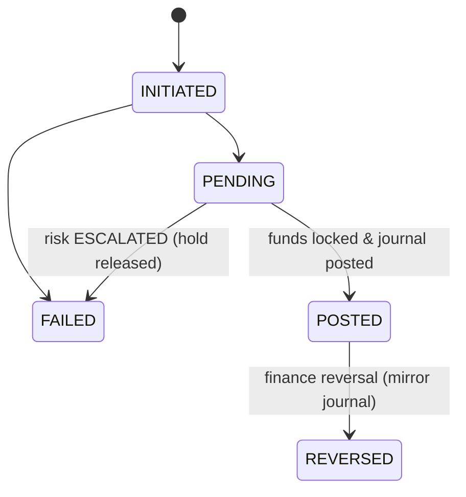

# FinCore API guide (SIMULATED funds)

The machine-readable contract is `GET /api/v1/openapi.json` (Swagger UI at `/api/docs`). This guide explains the semantics behind it.

## Conventions

- **Base path** `/api/v1`. Requests and responses are JSON.
- **Every response** carries an `x-request-id` header. The edge mints it, and it is propagated to the logs of api, workers and analytics.
- **Success envelope:** `{ "data": …, "meta": { "request_id": "req_…", "next_cursor": "…" } }`
- **Error envelope:** `{ "error": { "code", "message", "details": [{path, message}], "request_id" } }`. Errors never include stack traces or SQL.
- **Money:** `amount_minor` is a **string of integer minor units**, e.g. `"125050"` = ₹1,250.50. JSON numbers are rejected. Each transaction is single-currency (INR, USD or JPY); there is no FX.
- **Pagination:** `?limit=1..100&cursor=…`, in a stable `(created_at, id)` order. Pass `meta.next_cursor` back to get the next page. The ledger-line and audit endpoints use a numeric id cursor instead.
- **Auth:**
  - Browsers use httpOnly cookies, plus an `x-csrf-token` header (copied from the `fc_csrf` cookie) on unsafe methods.
  - API clients send `X-Token-Delivery: body` at MFA verify to receive tokens, then use `Authorization: Bearer`.

## Error catalog

| Code                     | HTTP | Meaning / client action                                                              |
| ------------------------ | ---- | ------------------------------------------------------------------------------------ |
| VALIDATION_ERROR         | 400  | Fix the fields listed in `details`                                                   |
| UNAUTHENTICATED          | 401  | Sign in or refresh                                                                   |
| REAUTH_REQUIRED          | 401  | Call `POST /auth/reauth` (password + TOTP), then retry with the same Idempotency-Key |
| FORBIDDEN                | 403  | Role not allowed (the denial is audited)                                             |
| NOT_FOUND                | 404  | The resource doesn't exist **or isn't yours** (deliberately not distinguished)       |
| CONFLICT                 | 409  | Duplicate, or the same idempotency key is in progress: retry later                   |
| INVALID_STATE_TRANSITION | 409  | Not allowed in the current state (e.g. a second reversal)                            |
| IDEMPOTENCY_KEY_REUSED   | 422  | The same key was used with a different body                                          |
| INSUFFICIENT_FUNDS       | 422  | Available = posted − held is below amount + fee                                      |
| LIMIT_EXCEEDED           | 422  | Per-transfer limit or refundable remainder exceeded                                  |
| RATE_LIMITED             | 429  | Wait for `Retry-After`                                                               |
| INTERNAL_ERROR           | 500  | Bug; quote the `request_id`                                                          |
| UPSTREAM_UNAVAILABLE     | 503  | A dependency is down or locks are busy: retry with the same Idempotency-Key          |

## Idempotency (all money-moving POSTs)

Send an `Idempotency-Key: <uuid>` header. Keys are scoped per user and expire after 24 h.

| Situation                 | Result                                                  |
| ------------------------- | ------------------------------------------------------- |
| Same key, same body       | The original response, with `Idempotent-Replayed: true` |
| Same key, different body  | 422                                                     |
| Same key still processing | 409                                                     |

The stored response commits **atomically** with the money movement (ADR-008), so a retry after a timeout can never double-post.

## Transaction lifecycle

**Transfers:**

- `201 POSTED` on success.
- `202 PENDING` if the risk score is ≥ 70 (funds held). An analyst then **clears** it (it posts) or **escalates** it (it fails).

**Payment intents (top-ups):**

1. `CREATED` → `REQUIRES_CONFIRMATION` → `PROCESSING` after confirm.
2. → `SUCCEEDED` / `FAILED` by webhook.
3. `CANCELED` is possible before processing.

**Refunds:** `REQUESTED` → `PROCESSING` → `SUCCEEDED` / `FAILED`. Funds are held at request time and move when the provider confirms.

**Disputes:** `OPEN` → `UNDER_REVIEW` → one of:

- `RESOLVED_CUSTOMER` (money returned; needs step-up);
- `RESOLVED_MERCHANT`;
- `REJECTED`.

**Settlements:** `EXPECTED` → `MATCHED` / `MISMATCHED` / `FAILED`; `MISMATCHED` and `FAILED` → `RESOLVED`.

Illegal transitions are rejected by the database itself and return 409. Every transition is recorded in `state_transitions` with the actor, reason and request id.

## Ledger semantics

Every movement is a balanced journal: one `transactions` row plus two or more `ledger_entries` rows, with Σ debits = Σ credits, enforced at COMMIT. Wallets are credit-normal liabilities.

| Event              | Debit                                               | Credit                                   |
| ------------------ | --------------------------------------------------- | ---------------------------------------- |
| Top-up             | PROVIDER_CLEARING                                   | wallet                                   |
| Transfer           | source (amount + fee)                               | destination (amount), FEES_REVENUE (fee) |
| Refund             | wallet                                              | PROVIDER_CLEARING                        |
| Settlement matched | SETTLEMENT_BANK                                     | PROVIDER_CLEARING                        |
| Settlement short   | SETTLEMENT_BANK (actual), SETTLEMENT_SUSPENSE (gap) | PROVIDER_CLEARING                        |
| Settlement failed  | SETTLEMENT_SUSPENSE                                 | PROVIDER_CLEARING                        |
| Reversal           | exact mirror of the original                        |                                          |

Ledger entries are append-only. Corrections are always new journals.

## Webhooks

`POST /api/v1/webhooks/payments` (SIMULATED provider) or `/webhooks/stripe` (Stripe **test mode**).

- **Signature header:** `fincore-signature: t=<unix>,v1=<hex HMAC-SHA256(secret, t + "." + rawBody)>`.
- **Rejected with 400 and audited:** a timestamp older than 5 minutes, or a bad signature.
- **Duplicates** (same provider event id) are acknowledged with `duplicate: true` and ignored.
- **Processing** is asynchronous and order-independent.

## Statements and exports

- `GET /statements?wallet_id&period=YYYY-MM` creates an immutable snapshot whose totals are cross-checked by the analytics service.
- `GET /statements/{id}/export?format=csv|pdf` returns CSV (protected against formula injection) or PDF, with a running balance and the SIMULATED label.

## Test-mode setup

1. `pnpm --filter @fincore/db db:local` starts Postgres 16 with the seed, without Docker.
2. Run the analytics service: `cd services/analytics && uv run uvicorn fincore_analytics.main:app`.
3. Run the API with `pnpm --filter @fincore/api dev`. `PAYMENT_PROVIDER=SIMULATOR` is the default.
4. Demo users: `alice@ / bob@ / chandra@ / support@ / ops@ / finance@ / admin@fincore.test`, password `FinCore-Demo-2026!`, TOTP secret `JBSWY3DPEHPK3PXP` (SIMULATED).
5. Postman: import `postman/fincore.postman_collection.json`. The "00 Smoke" folder runs end to end with Newman.
6. For Stripe: set `PAYMENT_PROVIDER=STRIPE_TEST`, `STRIPE_SECRET_KEY=sk_test_…` and `STRIPE_WEBHOOK_SECRET`. Live keys are refused.
