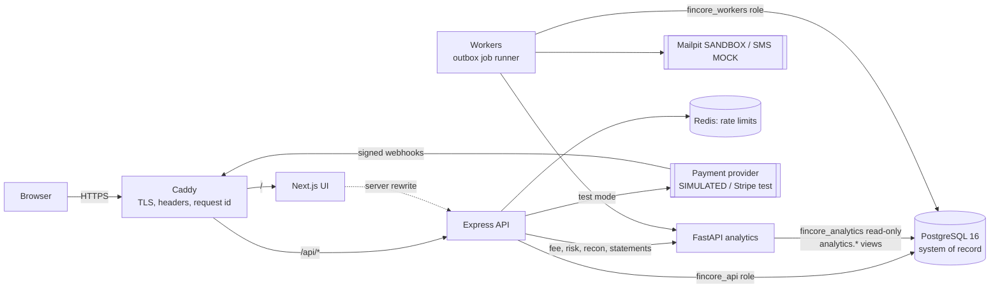

# Architecture

## Components



## Data flow: a transfer, from browser to database and back

```mermaid
sequenceDiagram
  participant U as Browser
  participant API as Express /transfers
  participant AN as Analytics
  participant DB as Postgres
  participant WK as Worker
  U->>API: POST /api/v1/transfers (cookie, x-csrf-token, Idempotency-Key)
  API->>DB: authenticate (session row) and claim idempotency key
  API->>DB: ownership: wallet and beneficiary WHERE customer_id = me
  API->>AN: fees/calculate (Decimal) and risk/score (300 ms, fail-safe)
  API->>DB: BEGIN; lock balances by ascending id; check funds
  API->>DB: INSERT transfer, journal (trigger updates balances), outbox, idempotency response, audit
  DB-->>API: COMMIT (deferred balance check passes)
  API-->>U: 201 POSTED {data, meta.request_id}
  WK->>DB: claim outbox job (SKIP LOCKED)
  WK->>WK: email (Mailpit) and SMS (MOCK)
```

Files on this path, in order:

- `apps/web/src/app/transfers/page.tsx` → `src/lib/api.ts`
- `apps/api/src/auth/middleware.ts` › `authenticate`
- `src/modules/transfers.ts` (POST `/transfers`)
- `src/lib/idempotency.ts` › `runIdempotent`
- `src/lib/db.ts` › `withTx`, `lockBalances`, `postJournal`
- the DB triggers in `db/migrations/20261127000500_ledger_journal.sql`
- `src/jobs/runner.ts` › `transfer.posted`

## Data ownership

See [PLAN.md §3](PLAN.md#3-data-ownership). Express owns every write. Analytics is stateless, apart from read-only views. Workers share the API's domain code (`@fincore/api/worker`).

## ER diagram

Ledger core: [assessments/03-ledger-database.md](assessments/03-ledger-database.md). Full planned model: [PLAN.md §6](PLAN.md#6-erd). The implemented schema matches it plus the Phase 3–7 tables: sessions, refresh tokens, MFA challenges, beneficiaries, fee schedules, transfers, reversals, risk alerts, idempotency keys, outbox, failed jobs, payment intents, refunds, disputes, provider events, settlement lines, reconciliation runs and items, and statements.

The live, generated types are in `packages/db/src/generated/db.ts`.
