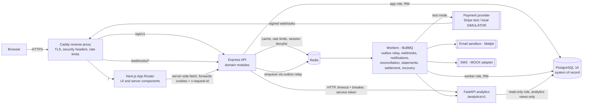

# FinCore: Phase 0 Plan

Status: **APPROVED** on 2026-11-27. Date: 2026-11-27.

This document covers the architecture, service boundaries, data ownership, ERD, core flows and delivery plan.
The decisions behind it are in [`adr/`](adr/README.md). All four ADRs were accepted in the Phase 0 review on 2026-11-27.

> All funds, cards, bank details and people in FinCore are **SIMULATED**. No real money, credentials or personal data are ever used.

---

## 1. Architecture

**Network zones (Compose / VM):**

- `edge`: Caddy only. It is the only container that publishes ports (80 and 443).
- `app`: web, api and analytics.
- `data`: Postgres, Redis and workers. This network is `internal: true`, so it has no route out.
- Workers also join `egress`, so they can reach the provider and email sandbox.
- Postgres and Redis are never published on host ports in staging or prod.

**Single origin.** The browser only ever talks to `https://<domain>`. Caddy routes `/api/v1/*` to Express and everything else to Next.js. Because of this:

- auth cookies can be `SameSite=Strict`;
- there is no cross-origin CORS surface;
- Next.js server components call Express over the internal network.

See ADR-004.

## 2. Service boundaries

| Service                  | Responsibility                                                                                                                                                                                                                                                               | Does NOT do                                                                                                        |
| ------------------------ | ---------------------------------------------------------------------------------------------------------------------------------------------------------------------------------------------------------------------------------------------------------------------------- | ------------------------------------------------------------------------------------------------------------------ |
| **web** (Next.js)        | Customer and ops UI, form UX validation, role-gated navigation. Server components fetch from the API with the user's cookie.                                                                                                                                                 | No business rules, no DB access, never holds tokens in JS.                                                         |
| **api** (Express, TS)    | Owns every authoritative write: auth, RBAC, wallets, ledger posting, transfers, payments, refunds, reversals, disputes, alerts workflow, statements metadata, audit, the webhook inbox and idempotency.                                                                      | No long-running work in the request path. No outbound provider calls inside DB transactions.                       |
| **workers** (BullMQ, TS) | Outbox relay, webhook event processing, notifications, reconciliation runs, statement generation, settlement processing, stuck-transfer recovery, idempotency-key GC. Shares the domain modules with api (same package), so there is one implementation of the ledger rules. | No HTTP surface except health and metrics.                                                                         |
| **analytics** (FastAPI)  | Pure `Decimal` calculations (fees, interest, statement summaries, reconciliation diffs), explainable risk scoring, and ops reports over read-only views.                                                                                                                     | Never writes to the DB. Never decides to move money: it returns numbers and scores, and Express posts the results. |

## 3. Data ownership

| Entity                                                                | Owner (writes)                                                                                                | Others                                                          |
| --------------------------------------------------------------------- | ------------------------------------------------------------------------------------------------------------- | --------------------------------------------------------------- |
| users, roles, user_roles, sessions, refresh_tokens, mfa_challenges    | api                                                                                                           | none                                                            |
| customers, wallets, beneficiaries                                     | api                                                                                                           | analytics reads masked views                                    |
| accounts, account_balances, transactions, ledger_entries, holds       | api ledger module (also used by workers)                                                                      | analytics reads aggregated views                                |
| transfers, payment_intents, refunds, reversals, disputes, settlements | api domain modules and workers                                                                                | analytics reads views                                           |
| state_transitions (history of every state machine)                    | api state-machine module                                                                                      | read only                                                       |
| provider_events (webhook inbox)                                       | api inserts; workers set processed status                                                                     | none                                                            |
| reconciliation_runs and reconciliation_items                          | workers. The diff is computed by analytics `/reconciliation/compare` and results are stored by workers.       | ops UI reads via api                                            |
| fee and interest **rules** (versioned config)                         | api `fee_schedules` table, edited by admins with reauth                                                       | sent to analytics in each request, so analytics stays stateless |
| fee and interest **calculation logic**                                | analytics (pure functions)                                                                                    | api calls it; the **result** is posted to the ledger by api     |
| risk score                                                            | analytics computes, returns `{score, reasons[]}`                                                              | api stores it on the transfer and/or a risk_alert               |
| risk_alerts (workflow state)                                          | api                                                                                                           | none                                                            |
| statements (metadata and file)                                        | workers generate; totals come from analytics `/statements/summarize` and are cross-checked against the ledger | api serves exports                                              |
| idempotency_keys, outbox, failed_jobs                                 | api and workers                                                                                               | none                                                            |
| audit_log                                                             | api and workers, append-only                                                                                  | read-only for ops, finance and admin                            |

**Integration contract.** Express pushes the inputs in the request body to fee, interest, risk and reconciliation calls (stateless analytics). Analytics reads the DB only for `GET /reports/operations` and velocity look-backs. Those reads go through the dedicated `analytics` schema of **views**, granted to a read-only role, so analytics never couples to raw table layouts and never sees password hashes, tokens or unmasked identifiers.

## 4. Money and ledger model (summary of ADR-001 and ADR-003)

- **Money type.** Amounts are `BIGINT` minor units plus `currency CHAR(3)`, and every table follows this.
  - A `currencies` table holds the ISO 4217 exponent (INR 2, USD 2, JPY 0).
  - In the JSON API, amounts are **strings of integer minor units** (`"amount_minor": "125050"`), so nobody has to trust IEEE-754 doubles.
  - TS uses `bigint` behind a `Money` value type, and ESLint bans `Number(...)`/`parseFloat` in money modules.
  - Python converts to `Decimal` at the boundary and uses an explicit `quantize`.
- **Chart of accounts.**
  - `accounts.type` ∈ ASSET, LIABILITY, EQUITY, REVENUE, EXPENSE, with a normal balance side.
  - Customer wallets are **LIABILITY** accounts: the platform owes the customer.
  - System accounts: `PROVIDER_CLEARING` (asset), `SETTLEMENT_BANK` (asset), `SETTLEMENT_SUSPENSE`, `DISPUTE_SUSPENSE`, `FEES_REVENUE`, `INTEREST_EXPENSE`, and `SIMULATED_FUNDING` (equity, used only by seed/demo top-ups and labelled SIMULATED).
  - There is one set of system accounts per currency.
- **Invariants enforced in the database:**
  1. A deferred constraint trigger checks Σdebit = Σcredit per `transaction_id` at commit.
  2. `ledger_entries` is append-only in two ways: a trigger raises on UPDATE, DELETE or TRUNCATE, and the app roles have no UPDATE/DELETE grant.
  3. Entries can only be added in the **same DB transaction** that created the header. `transactions.db_txid = txid_current()` is checked by a trigger, so nobody can append a balanced pair to an old journal.
  4. Corrections are new transactions with `reverses_transaction_id` (UNIQUE), so a transaction can be reversed at most once.
  5. Every entry has an FK to an account and to a transaction, `amount_minor > 0`, and `direction` ∈ {DEBIT, CREDIT}.
     - The composite FK `(account_id, currency) → accounts(id, currency)` makes a currency mismatch impossible.
     - The composite FK `(transaction_id, currency) → transactions(id, currency)` makes a transaction single-currency.
  6. `account_balances` is maintained **by trigger** from entries and holds, and has `CHECK (posted_minor - held_minor >= floor_minor)`. Customer wallets have floor 0, so an overdraft fails at the DB even if app logic is wrong.
     - System accounts don't keep a cached balance row. Their balance is derived from entries, which avoids a global hot-row lock.
- **Global invariant query.** Run after every integration test, in CI, as a metric, and by the capstone:
  - every transaction is balanced;
  - Σ debits = Σ credits overall;
  - every `account_balances` row equals the value recomputed from entries and active holds.

## 5. Key flows

**Transfer (wallet → beneficiary wallet)**

1. `POST /transfers` arrives with an `Idempotency-Key`. Zod validates the body. RBAC checks the caller is a customer. The source wallet is fetched with `WHERE owner_customer_id = $me`, and if it isn't found the API returns 404.
2. Above the threshold, the API also requires fresh reauth and a **transaction confirmation code** bound to `hash(amount, currency, beneficiary)`. This is simulated dynamic linking.
3. **Idempotency claim**, in its own short transaction: insert the key with `IN_PROGRESS` and a 60 s lease. The four cases are listed in §7.
4. **Tx A:** insert the transfer as `INITIATED`. Lock the source balance row `FOR UPDATE` (accounts locked in ascending id order), check the available balance, insert a hold, move to `PENDING`, commit.
5. Call analytics `POST /risk/score` with no DB locks held. Timeout is 300 ms, with a circuit breaker.
   - High score: the transfer stays `PENDING` with its hold, a `risk_alert` is created, and the API returns 202.
   - Analytics down: below the review threshold the transfer proceeds; at or above it, it is held for review (fail-safe).
6. **Tx B:** lock both balance rows in ascending id order, then:
   - post the journal (customer debit, beneficiary credit, fee pair);
   - release the hold and move to `POSTED`;
   - write the outbox `transfer.posted` row;
   - mark the idempotency key `COMPLETED` with the stored response.
     All of this commits together.
7. The outbox relay sends `transfer.posted` to a BullMQ job (jobId = outbox id, so it is deduplicated), which triggers an email (Mailpit) and an SMS (MOCK).
8. If the process crashes between Tx A and Tx B, the recovery worker finds stale `PENDING` transfers and resumes or fails them. The state checks make this idempotent.

**Top-up via payment intent:** `CREATED → REQUIRES_CONFIRMATION → PROCESSING`. The provider charges the test card. The signed webhook is verified (HMAC over the raw body, ≤ 5 min skew, constant-time compare) and inserted into `provider_events`; a unique `provider_event_id` makes duplicates a no-op 200. A worker then moves the intent to `SUCCEEDED` and posts DR `PROVIDER_CLEARING` / CR wallet. Out-of-order events are resolved by the state machine: a late `processing` after `succeeded` is recorded and ignored.

**Settlement:** a provider payout report or event creates `settlements`.

- Reconciliation matches each item to payment intents by provider ID and amount.
- **Matched:** DR `SETTLEMENT_BANK` / CR `PROVIDER_CLEARING`.
- **Mismatched:** the difference goes to `SETTLEMENT_SUSPENSE` and a risk/ops alert is raised.
- **Failed:** the full amount goes to suspense and an alert is raised. It can be recovered later with `→ RESOLVED` via a correcting transaction.

**Refund:** DR wallet / CR `PROVIDER_CLEARING`. The amount must be ≤ the refundable remainder; the DB check is `SUM(refunds) <= intent.amount` under a lock on the intent row. Finance only, with reauth.

**Reversal:** finance with reauth. Creates a new mirrored transaction with `reverses_transaction_id` set, and the transfer moves `POSTED → REVERSED`. A second reversal returns 409, enforced by both the state machine and the UNIQUE constraint.

**Dispute:** on `OPEN`, a hold is placed on the counterparty wallet if funds are available, otherwise the amount moves to `DISPUTE_SUSPENSE`. Resolution posts the final movement. A support agent can resolve up to a configured limit; above it, finance must resolve.

## 6. ERD

```mermaid
erDiagram
  users ||--o{ user_roles : has
  roles ||--o{ user_roles : grants
  users ||--o{ sessions : opens
  sessions ||--o{ refresh_tokens : rotates
  users ||--o{ mfa_challenges : receives
  users ||--o| customers : "is (customer role)"
  customers ||--o{ wallets : owns
  wallets ||--|| accounts : "backed by ledger account"
  currencies ||--o{ accounts : denominates
  accounts ||--o| account_balances : "cached balance (wallets only)"
  customers ||--o{ beneficiaries : saves
  wallets ||--o{ beneficiaries : "is target of"
  transactions ||--|{ ledger_entries : "lines (>=2, balanced)"
  accounts ||--o{ ledger_entries : "posted to"
  transactions |o--o| transactions : "reverses (unique)"
  accounts ||--o{ holds : "restricted by"
  wallets ||--o{ transfers : "source / destination"
  transfers ||--o{ holds : places
  transfers |o--o| transactions : "posted as"
  transfers ||--o| reversals : "reversed by"
  reversals ||--|| transactions : "posted as"
  wallets ||--o{ payment_intents : "top-up into"
  payment_intents |o--o| transactions : "posted as"
  payment_intents ||--o{ refunds : "refunded by"
  refunds |o--o| transactions : "posted as"
  disputes }o--o| transfers : "about"
  disputes }o--o| payment_intents : "about"
  disputes |o--o{ holds : places
  provider_events }o--o| payment_intents : "updates"
  settlements ||--o{ reconciliation_items : "itemised as"
  reconciliation_runs ||--|{ reconciliation_items : produces
  reconciliation_items }o--o| payment_intents : "matched to"
  reconciliation_items }o--o| provider_events : "evidenced by"
  settlements |o--o{ transactions : "posted as"
  risk_alerts }o--o| transfers : "flags"
  risk_alerts }o--o| customers : "about"
  wallets ||--o{ statements : "has"
  users ||--o{ idempotency_keys : "submits"
  users ||--o{ audit_log : "acts in"

  users {
    uuid id PK
    citext email UK
    text password_hash "argon2id"
    text mfa_secret_enc "AES-256-GCM"
    text status
    timestamptz created_at
  }
  roles { text code PK "CUSTOMER SUPPORT OPS FINANCE ADMIN" }
  user_roles { uuid user_id FK
    text role_code FK }
  sessions {
    uuid id PK
    uuid user_id FK
    timestamptz mfa_verified_at
    timestamptz reauth_at
    timestamptz revoked_at
    timestamptz expires_at
  }
  refresh_tokens {
    uuid id PK
    uuid session_id FK
    uuid family_id
    bytea token_hash UK "sha256"
    timestamptz used_at
    timestamptz revoked_at
  }
  mfa_challenges { uuid id PK
    uuid user_id FK
    text purpose "LOGIN REAUTH TXN_CONFIRM"
    bytea binding_hash
    int attempts
    timestamptz expires_at
    timestamptz consumed_at }
  customers { uuid id PK
    uuid user_id FK
    text full_name "synthetic"
    text kyc_status "SIMULATED" }
  currencies { text code PK
    smallint exponent }
  accounts {
    uuid id PK
    text code UK
    text type "ASSET LIABILITY EQUITY REVENUE EXPENSE"
    text normal_side
    text currency FK
    boolean is_system
  }
  account_balances {
    uuid account_id PK
    bigint posted_minor
    bigint held_minor
    bigint floor_minor "CHECK posted-held>=floor"
  }
  wallets { uuid id PK
    uuid customer_id FK
    uuid account_id FK
    text account_number UK "synthetic, masked in views"
    text status }
  beneficiaries { uuid id PK
    uuid customer_id FK
    uuid target_wallet_id FK
    text nickname
    timestamptz deleted_at }
  transactions {
    uuid id PK
    text kind "TRANSFER TOPUP REFUND REVERSAL FEE SETTLEMENT ..."
    text currency
    uuid reverses_transaction_id UK
    bigint db_txid
    timestamptz posted_at
  }
  ledger_entries {
    bigint id PK
    uuid transaction_id FK
    uuid account_id FK
    text direction "DEBIT CREDIT"
    bigint amount_minor "CHECK > 0"
    text currency
  }
  holds { uuid id PK
    uuid account_id FK
    bigint amount_minor
    text reason
    text status "ACTIVE RELEASED CAPTURED"
    timestamptz expires_at }
  transfers {
    uuid id PK
    uuid source_wallet_id FK
    uuid dest_wallet_id FK
    bigint amount_minor
    bigint fee_minor
    text currency
    text status
    uuid transaction_id FK
    numeric risk_score
  }
  payment_intents { uuid id PK
    uuid wallet_id FK
    bigint amount_minor
    text status
    text provider
    text provider_ref UK }
  refunds { uuid id PK
    uuid payment_intent_id FK
    bigint amount_minor
    text status
    text provider_ref UK }
  reversals { uuid id PK
    uuid transfer_id FK "UK"
    uuid transaction_id FK
    uuid approved_by FK
    text reason }
  disputes { uuid id PK
    uuid raised_by FK
    uuid transfer_id FK
    uuid payment_intent_id FK
    bigint amount_minor
    text status }
  settlements { uuid id PK
    text provider_payout_id UK
    bigint expected_minor
    bigint actual_minor
    text status }
  provider_events { uuid id PK
    text provider_event_id UK
    text type
    jsonb payload
    text status "RECEIVED PROCESSED IGNORED FAILED"
    timestamptz received_at }
  reconciliation_runs { uuid id PK
    date period
    text status
    jsonb summary }
  reconciliation_items { uuid id PK
    uuid run_id FK
    text outcome "MATCHED AMOUNT_MISMATCH MISSING_INTERNAL MISSING_PROVIDER"
    bigint diff_minor }
  risk_alerts { uuid id PK
    numeric score
    jsonb reasons
    text status
    uuid assignee_id FK }
  statements { uuid id PK
    uuid wallet_id FK
    date period_start
    date period_end
    bigint opening_minor
    bigint closing_minor
    text file_ref }
  idempotency_keys {
    uuid user_id PK
    uuid key PK
    text route
    bytea request_hash
    text status "IN_PROGRESS COMPLETED"
    int response_code
    jsonb response_body
    timestamptz locked_until
    timestamptz expires_at
  }
  outbox { bigint id PK
    text topic
    jsonb payload
    timestamptz published_at }
  failed_jobs { uuid id PK
    text queue
    text job_id
    jsonb payload "redacted"
    text error
    int attempts
    timestamptz replayed_at }
  state_transitions { bigint id PK
    text entity_type
    uuid entity_id
    text from_state
    text to_state
    uuid actor_id
    text reason
    timestamptz at }
  audit_log {
    bigint id PK
    uuid actor_id
    text action
    text resource_type
    uuid resource_id
    text outcome "ALLOWED DENIED"
    text request_id
    jsonb metadata "PII-redacted"
    bytea prev_hash
    bytea hash "tamper-evident chain"
  }
```

Notes:

- `state_transitions` is a single polymorphic history table, so it has no FK to the entity. It is written only by the state-machine module, inside the same transaction as the status change, and it is append-only through the same trigger as the ledger. The trade-off is documented in an ADR in Phase 2.
- `audit_log` is append-only and hash-chained, so tampering can be detected by verifying the chain.
- `fee_schedules` (versioned fee and interest rules) and `interest_accruals` are added in Phase 6. Interest posts `round(cumulative_accrued) − already_posted`, so no fractional minor units are ever stored in the ledger.

## 7. Cross-cutting conventions

- **IDs:** UUIDv7 generated in the app (time-ordered, index-friendly). `ledger_entries`, `outbox` and `audit_log` use `bigint identity` to give a total order.
- **API:**
  - responses use the `{data, meta}` / `{error}` envelope with the error catalog from the brief;
  - every response has `x-request-id`, which is accepted from the proxy or generated;
  - cursor pagination on `(created_at, id)`, with `limit` ≤ 100;
  - `/api/v1` prefix.
- **Idempotency.** Claim the key in a short transaction (`IN_PROGRESS`, 60 s lease). The money transaction marks it `COMPLETED` atomically with the effect. Then:
  - deterministic 4xx responses are stored and replayed;
  - transient 5xx responses release the key;
  - an expired lease can be taken over;
  - keys are deleted by a GC job after 24 h.
- **Outbox:** written in the same transaction as the business change. The relay polls with `FOR UPDATE SKIP LOCKED` and enqueues with BullMQ `jobId = outbox.id`.
- **Jobs:** every handler is idempotent (it checks state before acting). When retries are exhausted, the job goes to `failed_jobs`, and `POST /admin/failed-jobs/:id/replay` (admin with reauth) replays it.
- **Outbound calls:**
  - timeouts everywhere;
  - retries with exponential backoff and full jitter, for idempotent calls only;
  - the provider gets its own idempotency key on every call;
  - circuit breaker via `opossum`.
- **Observability:**
  - pino and structlog JSON logs, with `request_id`, `hashed user_id`, `route` and `latency_ms`, and redaction paths;
  - `prom-client` and `prometheus-fastapi-instrumentator` for metrics;
  - `/healthz`, `/readyz` and `/metrics`, where `/metrics` is internal only and blocked at Caddy;
  - graceful SIGTERM handling.
- **Tooling:**
  - pnpm workspaces (`apps/*`, `packages/*`) and Turborepo for task caching;
  - `uv` for Python;
  - ESLint, Prettier, Ruff and mypy;
  - Husky, commitlint and lint-staged;
  - Testcontainers for real Postgres and Redis in integration tests.
- **UI:** Tailwind and shadcn/ui (Radix primitives give accessible keyboard and focus behaviour), TanStack Query, React Hook Form and Zod. The Zod schemas are shared from `packages/contracts`.

## 8. Phase map (the brief's Section 12, with exit evidence)

| Phase | Deliverable highlights                                                                                                    | Exit gate                                                                                             |
| ----- | ------------------------------------------------------------------------------------------------------------------------- | ----------------------------------------------------------------------------------------------------- |
| 0     | This plan, ERD, ADR 001–004                                                                                               | Your approval                                                                                         |
| 1     | Monorepo, lint/type tooling, Compose (pg, redis, mailpit), CI skeleton, commitlint, PR template, CODEOWNERS, branch rules | `docker compose up` from a clean clone; CI green                                                      |
| 2     | Migrations, roles and grants, triggers, seed, invariant-check SQL                                                         | DB tests: UPDATE/DELETE refused, unbalanced commit refused, overdraft CHECK, cross-txn append refused |
| 3     | Auth, RBAC, TOTP, reauth, txn confirmation, audit, rate limits                                                            | IDOR, expired/revoked/reused refresh, and missing-reauth tests                                        |
| 4     | Transfer engine, idempotency, state machines, recovery worker                                                             | 50-way concurrent drain, A↔B opposing transfers, idempotency ×5                                       |
| 5     | Remaining APIs, OpenAPI generation, Postman                                                                               | Supertest and Newman green                                                                            |
| 6     | Analytics: calculations, risk, reports, synthetic generator                                                               | pytest, Hypothesis and benchmark                                                                      |
| 7     | Provider adapters, webhooks, notifications, reconciliation, refunds, disputes, settlements                                | Replay, bad signature, outage and out-of-order tests                                                  |
| 8     | Dashboards                                                                                                                | Playwright and axe                                                                                    |
| 9     | Test matrix completion, contract tests                                                                                    | Matrix fully green, specs match the implementation                                                    |
| 10    | Hardened images, full secure pipeline                                                                                     | Scans clean or justified, rollback demo                                                               |
| 11    | VM deploy, HTTPS, monitoring, encrypted backups, restore drill                                                            | RTO/RPO measured                                                                                      |
| 12    | Incident simulations, capstone, runbooks                                                                                  | 5 postmortems, `make capstone` green                                                                  |
| 13    | Docs, diagrams, REVIEW_PREP, demo                                                                                         | Submission checklist                                                                                  |

## 9. Risks identified up front

| Risk                                                                | Mitigation                                                                                                                                      |
| ------------------------------------------------------------------- | ----------------------------------------------------------------------------------------------------------------------------------------------- |
| Docker is not installed on the dev machine (Windows)                | Install Docker Desktop with the WSL2 backend, and develop inside WSL2 so `make` and `bash` scripts behave as they do on the Linux VM and in CI. |
| Branch protection on a **private** repo requires a paid GitHub plan | Make the repo public (it holds no secrets) or use GitHub Pro. See question 2.                                                                   |
| Required reviews with a solo developer                              | A second reviewer is needed for genuine approvals. See question 3.                                                                              |
| Hot system accounts serialising every transfer                      | System accounts have no cached-balance row, so they take no lock (ADR-003).                                                                     |
| Analytics outage blocking transfers                                 | Fail-safe policy plus a circuit breaker (§5, step 5).                                                                                           |
| Scope (15 assessments) vs time                                      | Correctness-critical paths come first (Phases 2–4). UI polish is last.                                                                          |

## 10. Phase 0 review decisions (2026-11-27)

The recommended default was accepted for every open question:

| #   | Question                        | Decision                                                                                                                                                                  |
| --- | ------------------------------- | ------------------------------------------------------------------------------------------------------------------------------------------------------------------------- |
| 1   | Dev environment                 | Docker Desktop with the WSL2 backend; develop inside WSL2. _Not yet installed; the user installs it._                                                                     |
| 2   | Repo visibility                 | **Public** GitHub repo, so rulesets work on the free plan; there are no secrets in Git.                                                                                   |
| 3   | Reviewers                       | Single maintainer. 0 required approvals, PRs and green checks mandatory, AI-assisted review recorded on money/migration PRs. See `docs/assessments/10-git-governance.md`. |
| 4   | Payment provider and SMS        | Local **SIMULATED** provider (failure injection) **plus** a Stripe **test-mode** adapter; SMS is a **MOCK** adapter; email goes to Mailpit.                               |
| 5   | Hosting                         | Single Linux VM running Compose and Caddy. Provider and domain are chosen before Phase 11 (ADR-013).                                                                      |
| 6   | Data access                     | Kysely, dbmate SQL migrations and kysely-codegen (ADR-002).                                                                                                               |
| 7   | Risk check in the transfer path | Synchronous scoring with a 300 ms timeout and a circuit breaker. When analytics is down, small transfers proceed and transfers at or above the review threshold are held. |
| 8   | Defaults                        | INR primary (USD and JPY seeded), pnpm and Turborepo, Tailwind (+ shadcn/ui from Phase 8), uv.                                                                            |

Tooling notes from Phase 1:

- ESLint is pinned to v9, because `eslint-plugin-react` (via `eslint-config-next`) doesn't support v10 yet.
- TypeScript is pinned to 5.9, because `typescript-eslint` supports `<6.1`.
- Node 22 LTS everywhere, matching the dev machine.

## 11. Phase 2 changes to the plan (2026-11-27)

- **Testcontainers → embedded PostgreSQL 16** (ADR-005), because the user asked to proceed without Docker. Tests still run on real Postgres 16 with the production role model.
- **State machines and their history moved into the database** (ADR-007). The app-side compare-and-set from ADR-003 stays as the first line of defense.
- **Planned ADRs were renumbered** to make room for 005–007. See `docs/adr/README.md`.
- Phase 2 implements the ledger core. These ERD tables arrive with their phases:
  - Phase 3: sessions, refresh tokens, MFA challenges;
  - Phase 4: transfers, reversals, idempotency keys, outbox, failed jobs;
  - Phase 5: beneficiaries, statements;
  - Phase 7: payment intents, refunds, disputes, provider events, reconciliation, risk alerts.
- The ERD as implemented so far is in `docs/assessments/03-ledger-database.md`.
