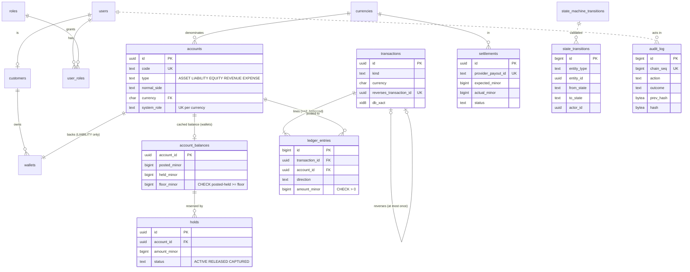

# Assessment 03: Double-entry ledger database

Status: **complete for Phase 2.** The transfer, payment, refund and dispute tables attach to this core in Phases 4–7.

## What is delivered

| Item                                                   | Location                                                                                                                                                                                               |
| ------------------------------------------------------ | ------------------------------------------------------------------------------------------------------------------------------------------------------------------------------------------------------ |
| Migrations (10, plain SQL, each with a working `down`) | [`db/migrations/`](../../db/migrations)                                                                                                                                                                |
| Role bootstrap (superuser, one-time)                   | [`db/bootstrap/roles.sql`](../../db/bootstrap/roles.sql), [`10-init-roles.sh`](../../db/bootstrap/10-init-roles.sh)                                                                                    |
| Seed (synthetic, idempotent)                           | [`packages/db/src/seed.ts`](../../packages/db/src/seed.ts)                                                                                                                                             |
| Invariant check (function and psql script)             | `ledger_invariant_violations()`, [`scripts/invariant-check.sql`](../../scripts/invariant-check.sql)                                                                                                    |
| Tamper and imbalance proof transcript                  | [`scripts/ledger-proof.sql`](../../scripts/ledger-proof.sql) → [`evidence/03/ledger-proof.txt`](../../evidence/03/ledger-proof.txt)                                                                    |
| DB test suite (real Postgres 16)                       | [`packages/db/test/`](../../packages/db/test)                                                                                                                                                          |
| Generated Kysely types (`bigint` for int8)             | [`packages/db/src/generated/db.ts`](../../packages/db/src/generated/db.ts)                                                                                                                             |
| Decisions                                              | [ADR-001](../adr/001-money-representation.md), [ADR-005](../adr/005-test-database-strategy.md), [ADR-006](../adr/006-database-enforced-integrity.md), [ADR-007](../adr/007-database-state-machines.md) |

## ER diagram (as implemented in Phase 2)



## Ledger semantics

- Every money movement is one row in `transactions` (the journal header) plus two or more rows in `ledger_entries` (the lines).
- Amounts are `BIGINT` minor units. Every line carries `currency`, which must match both its account and its journal (composite FKs).
- **Sign convention.** `account_balances.posted_minor` is in _normal-side_ terms. A customer wallet is a LIABILITY (credit-normal): a CREDIT increases it and a DEBIT decreases it.
- Globally, Σ debits = Σ credits per currency.
- **Available balance** = `posted_minor − held_minor`, and it must stay ≥ `floor_minor` (0 for wallets).
- **System accounts** (one per currency):

| Account             | Type                     |
| ------------------- | ------------------------ |
| PROVIDER_CLEARING   | asset                    |
| SETTLEMENT_BANK     | asset (SIMULATED)        |
| SETTLEMENT_SUSPENSE | asset                    |
| DISPUTE_SUSPENSE    | liability                |
| FEES_REVENUE        | revenue                  |
| INTEREST_EXPENSE    | expense                  |
| SIMULATED_FUNDING   | equity (demo money only) |

System accounts have no cached balance row, so they are never locked (ADR-003) and may run negative.

- **Corrections** are new journals only. A `REVERSAL` must exactly mirror its original, can happen once, and can't itself be reversed. Partial corrections (refunds) are separate journal kinds.

## How each requirement is enforced

| Requirement                          | Enforced by                                                                            | Proven by                                                                                |
| ------------------------------------ | -------------------------------------------------------------------------------------- | ---------------------------------------------------------------------------------------- |
| Immutable ledger entries             | No UPDATE/DELETE grant **and** `forbid_mutation()` triggers (UPDATE, DELETE, TRUNCATE) | `ledger.test.ts` › append-only; proof transcript §3–4                                    |
| Balanced journals                    | Deferred constraint trigger at COMMIT (FC002)                                          | `ledger.test.ts`; proof §2                                                               |
| No late lines on old journals        | `db_xact` check (FC003)                                                                | `ledger.test.ts`                                                                         |
| Valid references                     | FKs everywhere; composite FKs for currency                                             | `ledger.test.ts` (currency cases)                                                        |
| Appropriate precision                | `BIGINT` minor units, `amount > 0`; int8 parsed as `bigint`                            | `ledger.test.ts`; generated types                                                        |
| No overdraft, even under concurrency | Trigger-maintained balances + CHECK                                                    | `balances-holds.test.ts`: 50 concurrent debits → exactly 10 succeed, balance 0; proof §5 |
| Holds reduce available funds         | Trigger-maintained `held_minor`                                                        | `balances-holds.test.ts`                                                                 |
| Settlements                          | `settlements` with state machine, UNIQUE payout id, amount checks                      | `state-and-audit.test.ts`                                                                |
| Audit tables                         | Hash-chained `audit_log`; automatic `state_transitions`                                | `state-and-audit.test.ts` (30 concurrent writers; superuser tamper detected)             |
| Least privilege                      | Roles and column grants                                                                | `roles-and-constraints.test.ts`; proof §6                                                |
| Migrations reversible                | `down` in every file                                                                   | `migrations-and-invariants.test.ts` (full rollback → re-apply)                           |

## Error mapping (database → API)

| SQLSTATE / constraint               | Meaning                                            | API response                                                       |
| ----------------------------------- | -------------------------------------------------- | ------------------------------------------------------------------ |
| `23514` `available_not_below_floor` | Overdraft or over-hold                             | `422 INSUFFICIENT_FUNDS`                                           |
| `FC006`                             | Illegal state change                               | `409 INVALID_STATE_TRANSITION`                                     |
| `23505`                             | Duplicate (e.g. second reversal, duplicate payout) | `409 CONFLICT` (or a state error where specific)                   |
| `40001`, `40P01`                    | Serialization failure / deadlock                   | Retried by the transaction helper; if retries are exhausted, `503` |
| `FC001`–`FC005`, `FC007`, `42501`   | A bug in our code, never caused by user input      | `500 INTERNAL_ERROR`, logged with `request_id` and alerted         |

## Concurrency and retries

Covered in detail by ADR-003, which the transfer engine implements in Phase 4.

- The database layer alone already guarantees no overdraft. Under READ COMMITTED, concurrent balance updates queue on the row lock, and each re-checks the CHECK against the latest committed value.
- A duplicate request can't create a second reversal (UNIQUE).
- A crash mid-journal leaves nothing behind (single transaction; tested).
- The overdraft CHECK runs per line, so the posting service writes credits to a wallet before debits from the same wallet within one journal.

## Setup and demo (no Docker needed)

```bash
pnpm install
pnpm --filter @fincore/db test        # 59 DB tests on a throwaway PostgreSQL 16
pnpm --filter @fincore/db db:local    # persistent local DB on :54320, migrated and seeded; Ctrl+C to stop
# in another terminal, as the restricted app role:
PGPASSWORD=local-dev-only psql -h 127.0.0.1 -p 54320 -U fincore_api -d fincore -f scripts/ledger-proof.sql
PGPASSWORD=local-dev-only psql -h 127.0.0.1 -p 54320 -U fincore_api -d fincore -f scripts/invariant-check.sql
```

With Docker, `docker compose up` runs the role bootstrap and then the `migrate` service before the API starts. The API connects as `fincore_api`.

**Seeded synthetic users** (password `SEED_DEMO_PASSWORD`, default `FinCore-Demo-2026!`):

| User                                         | Role     | Wallets                                             |
| -------------------------------------------- | -------- | --------------------------------------------------- |
| alice@fincore.test                           | customer | ₹50,000.00 (FC1000000001), $1,000.00 (FC1000000002) |
| bob@fincore.test                             | customer | ₹25,000.00 (FC1000000003)                           |
| chandra@fincore.test                         | customer | ₹10,000.00 (FC1000000004)                           |
| dev@fincore.test                             | customer | ₹0.00 (FC1000000005)                                |
| support@, ops@, finance@, admin@fincore.test | staff    | none                                                |

## Evidence

- `evidence/03/db-test-run.txt`: full DB test run (real output)
- `evidence/03/ledger-proof.txt`: psql transcript as `fincore_api`, showing each refusal with its database error
- `evidence/03/invariant-check.txt`: invariant check on the seeded database (`OK`)

## Limitations

- The polymorphic `state_transitions.entity_id` and `transactions.reference_id` have no FK (ADR-007).
- The invariant check does full scans. That's fine at this scale; it would become incremental at scale.
- Audit writes are serialised by one advisory lock (ADR-006).
- A superuser can disable triggers. This can't be prevented from inside the database, but it is detectable through the audit chain and the invariant check.
