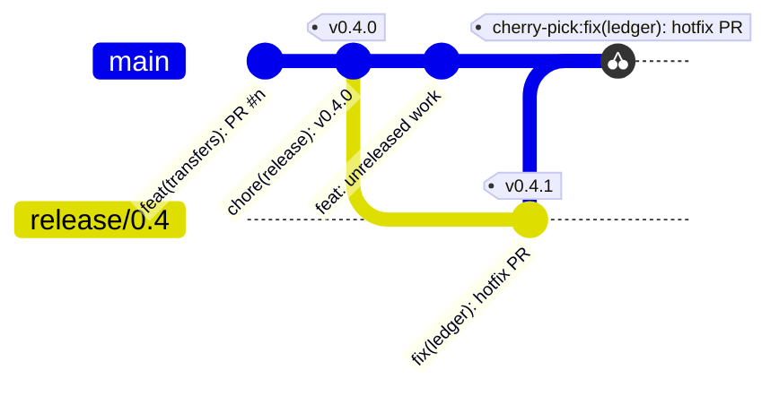

# Assessment 10: Git and change governance

Status: **in progress** (Phase 1 sets up the controls; real PR, tag and hotfix evidence follows once the repo is on GitHub).

## Controls

| Control                                                                                                                                                 | Where                                     | Enforced by                                                              |
| ------------------------------------------------------------------------------------------------------------------------------------------------------- | ----------------------------------------- | ------------------------------------------------------------------------ |
| Conventional Commits with an allowed scope list                                                                                                         | `commitlint.config.mjs`                   | `.husky/commit-msg` locally; `commitlint` CI job on every PR             |
| Formatting on commit                                                                                                                                    | `lint-staged` in `package.json`           | `.husky/pre-commit`                                                      |
| Protected `main`: no direct push, no force-push, no deletion, linear history, PR required, conversations resolved, required checks green and up to date | `.github/rulesets/main-branch.json`       | GitHub ruleset (applied by `scripts/github/apply-rulesets.sh`)           |
| Release tags `v*` can't be moved or deleted                                                                                                             | `.github/rulesets/release-tags.json`      | GitHub ruleset                                                           |
| Owners for ledger, money, calculation, migration, auth and infra paths                                                                                  | `.github/CODEOWNERS`                      | Review requests; enforced when a second reviewer exists (see below)      |
| Migration review checklist                                                                                                                              | `.github/pull_request_template.md`        | PR template; CI check that applied migrations are never edited (Phase 2) |
| Dependency updates                                                                                                                                      | `.github/dependabot.yml`                  | Weekly grouped PRs                                                       |
| Semantic versioning and changelog                                                                                                                       | `CHANGELOG.md`, tags `vMAJOR.MINOR.PATCH` | Release flow below                                                       |

## Reviewer policy (single maintainer)

GitHub does not let an author approve their own PR. With one maintainer, "1 required approval" would block every merge. The ruleset therefore requires **0 approvals** but still forces every change through a PR with green checks. To keep review real:

- every PR touching `ledger/`, `transfers/`, `payments/`, `refunds/`, `calculations/` or `db/migrations/` gets an AI-assisted review (`/code-review`), recorded as a PR comment;
- the author completes the PR template's ledger and migration checklists.

If a mentor or peer becomes available, set `required_approving_review_count: 1` and `require_code_owner_review: true` in the ruleset and replace `@fincore-owner` in CODEOWNERS.

## Setting up on GitHub

```bash
gh repo create <owner>/fincore --public --source . --push
scripts/github/apply-rulesets.sh <owner>/fincore
```

Replace `@fincore-owner` in `.github/CODEOWNERS` with your handle. Then capture screenshots of _Settings → Rules → Rulesets_ into `evidence/10/`.

## Branching, release and hotfix flow



**Normal change:** create a `feat/…` or `fix/…` branch, open a PR, wait for CI to go green, then squash-merge to `main`.

**Release:**

1. Update `CHANGELOG.md`: move Unreleased into the new version.
2. Open the PR `chore(release): vX.Y.Z` and merge it.
3. Tag the merge commit `vX.Y.Z` and push the tag. Phase 10 CI then builds versioned images for that tag.

**Hotfix**, for a defect in the released `vX.Y.Z` while `main` has moved on:

1. `git switch -c hotfix/X.Y.(Z+1) vX.Y.Z`. Branching from the **tag** means only the fix ships.
2. Commit `fix(scope): …` and add a regression test.
3. Open a PR into a short-lived `release/X.Y` branch created from the tag. CI must be green.
4. Tag `vX.Y.(Z+1)` on that branch and deploy (Phase 11 deploys by tag).
5. **Back-merge:** open a PR cherry-picking the fix into `main`, so the next release doesn't regress.

Evidence of a real hotfix PR and tag is captured in Phase 10 (`evidence/10/`).
